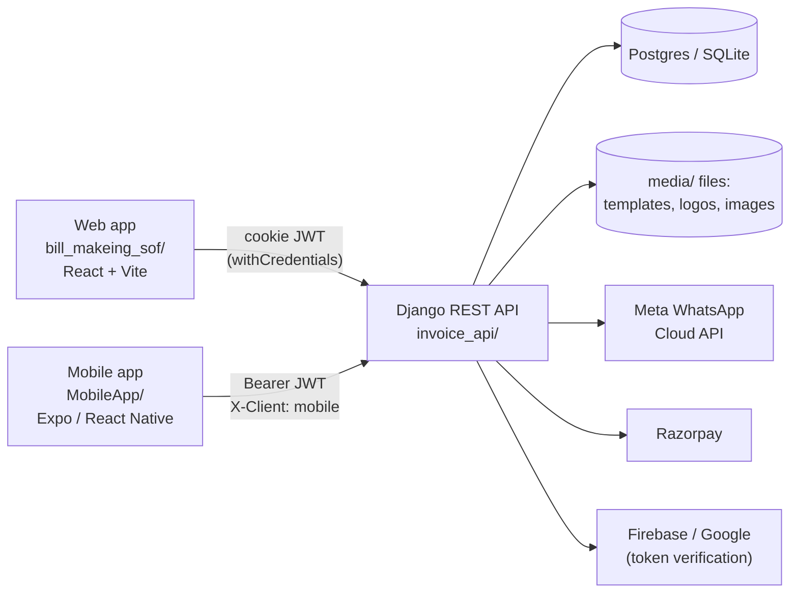

# System architecture

## The three apps

| App | Path | Stack | Talks to the API via |
|---|---|---|---|
| Backend | `invoice_api/` | Django + DRF, WeasyPrint, ReportLab | — |
| Web | `bill_makeing_sof/` | React, Vite, Redux, Tailwind/shadcn | `src/axios.js` (`clientToken`), base URL `VITE_APP_URL`, cookies |
| Mobile | `MobileApp/` | Expo Router, React Query, Zustand | `services/api.ts`, base URL `EXPO_PUBLIC_API_URL` + `/api/` |

## Backend Django apps

| App | Owns |
|---|---|
| `accounts` | User, `UserCompanies` (the tenant), signup/login, roles & permissions (authz), invites, devices, onboarding checklist |
| `companies` | Customers, vendors, subscription plans/features, trial, expiry crons |
| `invoice` | Invoice, line items (`Product`, `Product_properties`), bill columns (`new_product_in_frontend`), numbering, header config, PDF/CSV export, reports, purchase OCR |
| `yaml_manager` | Invoice templates (`Yaml`, `YamlVersion`), global gallery, previews |
| `bill_share` | `POST /api/share_by_whatsapp/` and the `BillShare` send log |
| `whatsapp_integration` | Own-number integration, shared platform account, company mode, WA templates |
| `inventory` | Inventory products, categories, suppliers, stock movements |
| `billing` | Razorpay subscriptions and webhooks (see `BILLING.md`) |

All routes are mounted under `/api/` in `invoice_api/invoice_api/urls.py` (inventory at `/api/inventory/`).

## Request pipeline

1. **Authentication** — `accounts.authenticate.CustomAuthentication` (JWT). Web sends the token in an http-only cookie (`SIMPLE_JWT['AUTH_COOKIE']`) plus CSRF; mobile sends `Authorization: Bearer …`. Login-type endpoints return the access token in the body only when the request carries `X-Client: mobile`.
2. **Tenant context** — `invoice_api/middleware.py` attaches lazy `request.company`, `request.subscription`, `request.features` (plan feature codes) and `request.permissions` (permission codes, cached per company and invalidated by `accounts/signals.py`).
3. **Gates** on each view (`invoice_api/permissions.py`):
   - `HasFeature.with_code('x')` / `HasMethodFeature` + `required_features_map` — plan feature; failure is `UpgradeRequired` (403, `code: upgrade_required`).
   - `HasMethodPermission` + `required_permissions_map` — role permission such as `invoice.create`, `template.manage`, `whatsapp.send`, `inventory.manage`.
   - `enforce_limit()` / `get_limit()` in `invoice_api/limits.py` — numeric plan limits (`invoices_per_month`, `sends_per_day`, …). Missing key = unlimited.
4. **Scoping** — older models are keyed to the creating `user`, so reads use `user_scope_q(request)` (`invoice_api/scoping.py`) to widen to "any member of my company". Company-wide config (bill columns, custom fields) belongs to `company_config_owner(request)`, the company's first admin. Newer models (inventory, templates) carry a `company` FK directly.

Both clients react to `upgrade_required` responses: mobile via `setApiHandlers({ onUpgradeRequired })` in `services/api.ts`, web via its axios interceptor.

## Soft delete

Most business models extend `invoice_api/softdelete.py:SoftDeleteModel` — `delete()` sets `is_deleted`, default managers hide deleted rows, unique constraints are conditional on `is_deleted=False`.
