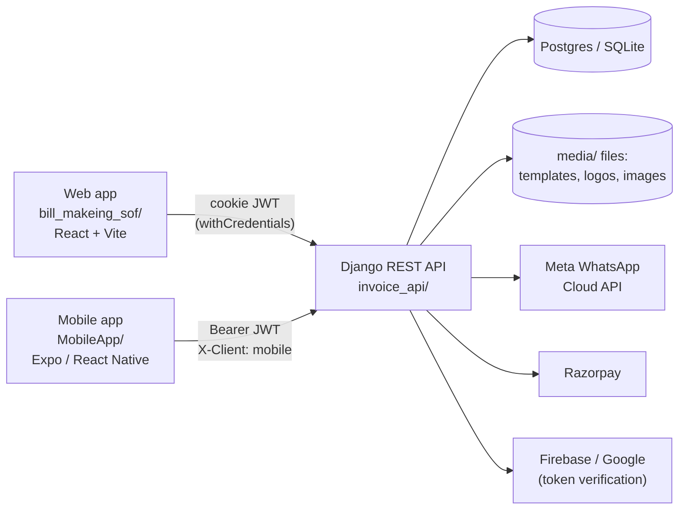

# System architecture

## The three apps

| App | Path | Stack | Talks to the API via |
|---|---|---|---|
| Backend | `invoice_api/` | Django + DRF, WeasyPrint, ReportLab | — |
| Web | `bill_makeing_sof/` | React, Vite, Redux, Tailwind/shadcn | `src/axios.js` (`clientToken`), base URL `VITE_APP_URL`, cookies |
| Mobile | `MobileApp/` | Expo Router, React Query, Zustand | `services/api.ts`, base URL `EXPO_PUBLIC_API_URL` + `/api/` |

## Backend Django apps

| App | Owns |
|---|---|
| `accounts` | User, `UserCompanies` (the tenant), signup/login, roles & permissions (authz), invites, devices, onboarding checklist |
| `companies` | Customers, vendors, subscription plans/features, trial, expiry crons |
| `invoice` | Invoice, line items (`Product`, `Product_properties`), bill columns (`new_product_in_frontend`), numbering, header config, PDF/CSV export, reports, purchase OCR |
| `yaml_manager` | Invoice templates (`Yaml`, `YamlVersion`), global gallery, previews |
| `bill_share` | `POST /api/share_by_whatsapp/` and the `BillShare` send log |
| `whatsapp_integration` | Own-number integration, shared platform account, company mode, WA templates |
| `inventory` | Inventory products, categories, suppliers, stock movements |
| `billing` | Razorpay subscriptions and webhooks (see `BILLING.md`) |

All routes are mounted under `/api/` in `invoice_api/invoice_api/urls.py` (inventory at `/api/inventory/`).

## Request pipeline

1. **Authentication** — `accounts.authenticate.CustomAuthentication` (JWT). Web sends the token in an http-only cookie (`SIMPLE_JWT['AUTH_COOKIE']`) plus CSRF; mobile sends `Authorization: Bearer …`. Login-type endpoints return the access token in the body only when the request carries `X-Client: mobile`.
2. **Tenant context** — `invoice_api/middleware.py` attaches lazy `request.company`, `request.subscription` (`plan_code`, `status`, `end_date`, `auto_renew`; returned as-is by `authz/me/`), `request.features` (plan feature codes) and `request.permissions` (permission codes, cached per company and invalidated by `accounts/signals.py`).
3. **Gates** on each view (`invoice_api/permissions.py`):
   - `HasFeature.with_code('x')` / `HasMethodFeature` + `required_features_map` — plan feature; failure is `UpgradeRequired` (403, `code: upgrade_required`).
   - `HasMethodPermission` + `required_permissions_map` — role permission such as `invoice.create`, `template.manage`, `whatsapp.send`, `inventory.manage`.
   - `enforce_limit()` / `get_limit()` in `invoice_api/limits.py` — numeric plan limits (`invoices_per_month`, `sends_per_day`, …). Missing key = unlimited.
   - `is_free_plan(request)` in the same file — true on the Free plan or with no working subscription (not on a Pro trial); used to print the "Made with Orvine" footer on exported PDFs ([pdf-export.md](pdf-export.md)).
4. **Scoping** — older models are keyed to the creating `user`, so reads use `user_scope_q(request)` (`invoice_api/scoping.py`) to widen to "any member of my company". Company-wide config (bill columns, custom fields) belongs to `company_config_owner(request)`, the company's first admin. Newer models (inventory, templates) carry a `company` FK directly.

Both clients react to `upgrade_required` responses: mobile via `setApiHandlers({ onUpgradeRequired })` in `services/api.ts`, web via its axios interceptor.

## Platform Admin (product owner)

Web route `/platform-admin` (`bill_makeing_sof/src/pages/PlatformAdmin.jsx`, tabs in `src/pages/platform-admin/`). The page shows a "no access" card unless `state.access.isProductOwner`; every API behind it is gated by `IsProductOwner` (`is_superuser`, or the global `Product Owner` role) in `invoice_api/permissions.py`. The active tab and its filter presets live in the URL (`?tab=companies&status=trialing`), so the Overview links straight into a filtered list.

| Tab | API (all under `/api/admin/`) | Notes |
|---|---|---|
| Overview | `overview/` | Company/user counts, companies by subscription status (incl. `none`), trials ending in 7 days, paid subs ending in 30 days, MRR estimate (active + past_due at the plan's monthly price), companies per plan, and `billing` (same dict as `billing/health/`, from `billing.api.views_admin.billing_health`). |
| Companies | `companies/` (paginated: `?search=` name/email/phone/GSTIN/#id, `?plan=<code>`, `?status=active\|trialing\|past_due\|none`, `?ending_within=<days>`, `?ordering=`), `companies/{id}/subscription/` GET history · POST assign · PUT extend/status/auto-renew | Drawer per company. POST/PUT write an `AuditLog` row (`resource_type=SUBSCRIPTION`, action `ASSIGN`/`UPDATE`, actor, `previous_data`), in addition to the actor-less row from the `CompanySubscription` post_save signal. PUT rejects `end_date` before `start_date`. |
| Plans | `plans/` (+ `subscriber_count`), `plans/{id}/features/`, `plans/{id}/features/{pf}/` | Limits edited as key/value rows (or raw JSON); limits must be a JSON object. Delete is blocked while the plan has working subscriptions. "Duplicate" creates an inactive copy with the same features and limits. |
| Features | `features/` (+ `plans` list) | Code is immutable after create. DELETE returns 400 with `plans` when the feature is attached; the UI confirms and resends with `?force=1`. |
| Billing | `billing/*` (see `BILLING.md`) | Subscriptions, payments, webhook events and scheduled changes are paginated. Sync plans / Apply scheduled / Reconcile ask for confirmation. |
| WhatsApp | `whatsapp-account/` | Shared platform account (see `whatsapp-messaging.md`). |
| Audit log | `audit-log/` (paginated, 50/page: `?company=`, `?resource_type=`, `?action=`, `?user=` username contains, `?date_from=`/`?date_to=` YYYY-MM-DD), `audit-log/facets/` | Row expands to a before/after diff; "Export page" downloads the current page as CSV. |

Admin list endpoints use `invoice_api/pagination.py:AdminPagination` (`{count, next, previous, results}`, `?page=`, `?page_size=` ≤ 200). The global DRF pagination is still off.

On phones (≤ 640px, `platform-admin.css`) tables become stacked cards: the shared `<Table>` in `shared.jsx` copies each column header onto its cells as `data-label` (walking into Fragments, skipping `colSpan` cells), and CSS shows it as the row label. Cells with an empty header (actions) span the card; the audit expand arrow is hidden because the whole row is tappable. Filters go two per row, the drawer is full width, confirm dialogs become bottom sheets, inputs are 16px so iOS doesn't zoom, and the page leaves room for the fixed mobile bottom bar.

### Known gaps

- MRR is an estimate: it doesn't know whether a company pays monthly or yearly, and ignores discounts.
- Company list filters (`plan`, `status`, `ending_within`) look at working subscriptions only; there is no filter on cancelled/expired history.
- CSV export covers the current page only.

## Tenant isolation of records

Records are scoped to the requester's company with `invoice_api/scoping.py:user_scope_q` (rows whose creator belongs to the company). Edit and delete endpoints must look the record up through that filter, not by bare id, so another company's id is indistinguishable from a missing one (customers, vendors and line items do this; tests in `accounts/tests_tenant_isolation.py`). An edit never changes a record's creator.

Invites: `POST invites/{token}/accept/` creates the user (username and password required) or, for an email that already has an account, requires that account's password. The link alone never logs anyone in and never re-enables a disabled account.

## Soft delete

Most business models extend `invoice_api/softdelete.py:SoftDeleteModel` — `delete()` sets `is_deleted`, default managers hide deleted rows, unique constraints are conditional on `is_deleted=False`.

## Deleting a company (hard delete)

`UserCompanies` is not soft-deleted. Deleting one (Django admin row delete or bulk "delete selected", `accounts/deletion.py` purge helpers, or `.delete()` in a shell) cascades to everything with a `company` FK, including its members (`User.user_company` is `CASCADE`), roles, permissions, subscriptions and `AuditLog` rows.

- **Audit rows are skipped during the cascade.** The `post_delete` handlers in `accounts/signals.py` would otherwise write new `AuditLog` rows pointing at the company being deleted, and SQLite's deferred FK check then fails at commit (`IntegrityError: FOREIGN KEY constraint failed`). `audit()` returns early when the signal's `origin` is a `UserCompanies` instance or queryset (`_company_delete_origin`), or inside `audit_muted()`, which the purge helpers use. Other deletes are still audited.
- **Companies with a superuser are protected in the admin.** `UserCompaniesAdmin.get_deleted_objects` (`accounts/admin.py`) lists each superuser member as protected, so both delete paths stop on Django's "cannot delete" page. Same rule as `deletion.purge_user_and_company`.
- Tests: `accounts/tests_company_admin_delete.py` (run `connection.check_constraints()`, because `TestCase` never commits).

### Known gaps

- Admin deletion leaves the company logo and members' profile pictures on disk. The `accounts/deletion.py` helpers remove them.

_Last reviewed against the code: 2026-11-19._
