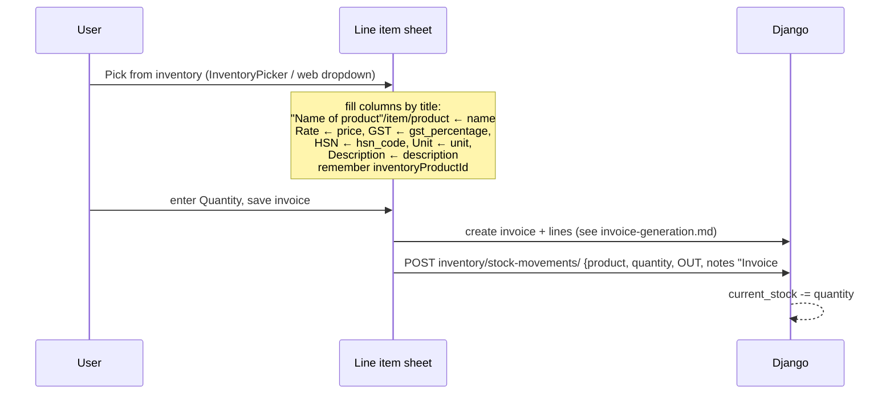

# Inventory flow

Products with stock levels, categories, stock movements, and how invoices take stock out.

## Models (`invoice_api/inventory/models.py`)

All are company-scoped (`company` FK) and soft-deleted.

| Model | Key fields |
|---|---|
| `Category` | `name` (unique per company among live rows) |
| `Supplier` | Legacy standalone supplier, superseded by `Product.vendor` |
| `Product` | `sku` (unique per company), `name`, `price`, `gst_percentage` (default 18), `hsn_code` (4/6/8 digits), `unit` (GST unit code, e.g. NOS), `tax_category` (for 0% items: nil-rated / exempt / non-GST), `current_stock`, `reorder_level` (default 10), `category`, `vendor` (a `companies.Vendor`) |
| `StockMovement` | `product`, `quantity` (> 0), `movement_type` `IN`/`OUT`, `notes`, `date` |

Inventory `Product` is a different table from the invoice line item `invoice.Product`. A line item only remembers it came from inventory on the client while the invoice is being built.

## Stock rules

- `current_stock` changes **only** through `StockMovement`: on create, `IN` adds and `OUT` subtracts; updating a movement does not re-apply it; deleting one (soft) reverses it.
- Stock can go negative; nothing blocks an `OUT` larger than stock.
- Low stock = `current_stock <= reorder_level` (`isLowStock` in `MobileApp/services/inventory.ts`).

## API (`/api/inventory/…`)

DRF router in `inventory/api/urls.py`; every viewset requires the `inventory` plan feature and the `inventory.manage` permission.

| Route | Notes |
|---|---|
| `products/` | Search `name`, `sku`, `description`; filter `category`, `supplier`, `vendor`. Vendor must belong to the company |
| `categories/` | Search name/description |
| `suppliers/` | Legacy |
| `stock-movements/` | Filter `product`, `movement_type`; create rejects a product from another company |

`company` is stamped from the request on create and is read-only.

## Screens

- **Mobile:** `app/inventory/index.tsx` (list, low-stock), `inventory/[id].tsx` (edit + movement history + add movement), `inventory/categories.tsx`, `inventory/scan.tsx` (barcode via `expo-camera` → `findBySku`).
- **Web:** `pages/inventory.jsx` and `comonant/inventory/`.

## From inventory to invoice

- The line-item sheet also takes the item's 0% category (mobile), and on a purchase bill offers a per-line input-credit choice.
- **Mobile** (`components/line-item-modal.tsx`, `services/invoices.ts:deductStock`): runs after every line is saved, so a rolled-back invoice never moves stock. Needs a column titled exactly `Quantity`; non-integer or ≤ 0 quantities are skipped with a warning; failures become warnings shown after save, not errors.
- **Web** (`comonant/new_bill_body.jsx`): posts the `OUT` movement per line right after the line is attached, fire-and-forget.

## Known gaps

- Column matching is by title text, so renaming the Rate/GST/Quantity columns silently stops prefill or stock deduction.
- Editing or deleting an invoice does not put stock back; only newly added lines deduct.
- Purchases do not add stock automatically; stock-in is a manual `IN` movement.
- Web and mobile deduct at different points (per line vs after all lines).
