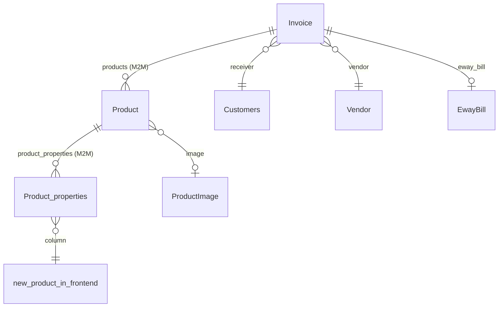

# Invoice generation flow

How a sales (or purchase) invoice gets created, filled with line items and totalled. Turning it into a PDF is in [pdf-export.md](pdf-export.md).

## Data model



| Model (`invoice/models.py`) | What it is |
|---|---|
| `Invoice` | Header: number, `receiver` (sales) or `vendor` (purchase), date, due date, `place_of_supply`, payment status/method, notes, terms, `custom_header_field` (JSON), `gst_final_amount`, `total_final_amount`, `invoice_type` (`sales`/`purchase`), `reverse_charge`, `itc_eligibility` (purchases: `eligible` / `blocked` / `reversal`) |
| `Product` | One line item. Stores `total_amount`, `gst_amount`, optional `image`, `tax_category` (0% lines: `nil` / `exempt` / `non_gst`; else `taxable`) and `itc_eligibility` (purchase lines; blank = the invoice's). Not linked to inventory. `user` is the creator: line items are created before they are attached to an invoice, so company scoping goes through it (`user_scope_q`). Items never attached to an invoice before migration `0031` have no owner and are unreachable through the API |
| `Product_properties` | One cell of a line: a `value` for one column |
| `EwayBill` | Sales only, one per invoice: e-way bill Part A extras (sub-type, document type, optional ship-to address, distance) and Part B (mode, vehicle, transporter, transport doc), plus the EWB number, date, `valid_until` and `status` (`draft` / `generated` / `cancelled`) the user types back from the portal. See "E-way bills" below |
| `new_product_in_frontend` | A **bill column** the company configured: `input_title`, `is_calculable`, `formula` (`+ - / %+ %-` or empty = multiply), `on_with_out_gst_amount`, `show_calculated_value`, presets, default |

Columns are company-wide and owned by `company_config_owner`. Every new account gets four: Description, Quantity, Rate, GST (see [user-signup.md](user-signup.md)). A column whose title is recognised by `invoice_api/gst.py:is_gst_column` is the GST rate column.

## Line calculation

Implemented three times and kept equivalent:

- Mobile: `MobileApp/lib/invoice-calc.ts` (`calculateLine`)
- Web: `calculateProductTotals` in `bill_makeing_sof/src/comonant/new_bill_body.jsx`
- **Server (authoritative):** `invoice_api/invoice/line_calc.py`

A 0% line's category and a purchase line's input-credit override are set in the app's line-item screen and the web line popup (`constants/gst.js:lineTaxCategory`), and picking an inventory item brings its category.

GST cells: a value in the GST-rate column must be a GST slab, and a value in an HSN-titled column 4, 6 or 8 digits (`invoice/api/views.py`, 400 otherwise).

Rules: running total starts at 1; plain calculable columns (no formula) multiply in first; formula columns apply after, either into the taxable total or, with `on_with_out_gst_amount`, into an "extra" added after tax; GST = rate% × running total; a line with no calculable input is 0. `line_total = total + gst + extra`.

The server **recomputes** on every write: `recompute_for_product()` after a line or cell changes, `recompute_invoice_totals()` (sum of lines; on a `reverse_charge` invoice the total leaves out the GST, which the recipient pays) after the invoice or its line set changes. Client-sent totals only survive for an invoice with no lines (e.g. a scanned purchase bill).

## Create flow (mobile)

`MobileApp/components/invoice-form.tsx` → `createInvoice()` in `MobileApp/services/invoices.ts`:

```mermaid
sequenceDiagram
  participant App as Mobile invoice form
  participant API as Django API
  App->>API: GET new/product/in/frontend/ (columns), invoice-header-config/
  App->>API: POST invoice/ (header, totals; no number if blank)
  Note over API: enforce_limit invoices_per_month<br/>next_invoice_number() if blank<br/>header_config.apply_defaults()<br/>save + recompute_invoice_totals
  API-->>App: invoice {id, invoice_number, ...}
  loop each line
    App->>API: POST product/ (amounts)
    App->>API: POST invoice/{id}/product/add/ {product_id}
    loop each column
      App->>API: POST product/properties/ {new_product_in_frontend, value}
    end
    App->>API: POST product/{pid}/update/ {product_properties: "1,2,3"}
    Note over API: recompute_for_product → line + invoice totals
  end
  opt line picked from inventory
    App->>API: POST inventory/stock-movements/ (OUT)
  end
```

- If any line fails, the app deletes the half-built invoice (`deleteInvoice`) so no number is wasted on an invisible invoice.
- Stock deduction runs only after all lines saved and returns warnings instead of failing (see [inventory.md](inventory.md)).
- Offline: if the save fails with a network error, the form offers to keep it as a local draft (`store/drafts.ts`, `app/drafts.tsx`).

**Editing** (`invoice/edit/[id]`): `POST invoice/{id}/update/` for the header, `DELETE product/{pid}/update/` for removed lines, `updateLineItem()` for changed cells, `addLineItem()` for new lines, then `syncTotals()`.

## Create flow (web)

`bill_makeing_sof/src/pages/new_bill.jsx` → `comonant/new_bill_body.jsx`. Same endpoints, multipart `FormData`, and the invoice row is created lazily (`ensureInvoiceId`) when the first line is added. Inventory stock-out is fire-and-forget per line.

The desktop items table renders one cell per visible column in `bill_body_items` (looking up each line's property by field id), so a line missing a property (e.g. a field added after the bill was created) shows an empty cell instead of shifting later columns left.

## Server-side steps on `POST /api/invoice/`

`InvoiceView.post` (`invoice/api/views.py`):

1. **Permission** `invoice.create`.
2. **Plan limit** — counts this month's invoices of the same type for the company; `invoicing.invoices_per_month` for sales, `purchases_invoice.purchases_per_month` for purchases.
3. **Numbering** — for sales with a blank/`"null"` number, `invoice/numbering.py:next_invoice_number(company)` reserves the next number from `CompanyInvoiceNumbering` (template with tokens, reset period never/yearly/FY/monthly, CAS retry). A supplied number always wins; purchases never draw from the series. Configured at `invoice-numbering/` (web `UIConfigNumbering.jsx`, mobile `app/numbering.tsx`).
4. **Header defaults** — `invoice/header_config.py:apply_defaults()` fills fields the client left out from `InvoiceHeaderConfig` (`invoice-header-config/`).
5. **Validate & save** — `InvoiceSerializer` (GST state code, custom header field shape; on sales, a new or changed number must be at most 16 letters, digits, `-` or `/` and unique in its financial year, CGST Rule 46(b)), then `recompute_invoice_totals`. Numbering templates whose numbers would break that rule are refused.
6. Response includes balance fields (`add_balance_fields`).

## Other endpoints

| Endpoint | Purpose |
|---|---|
| `GET invoice/` | List (filters, search, ordering, `status_group=open|overdue`), company-scoped |
| `GET invoice/summary/` | Totals for the list header |
| `POST invoice/{id}/product/{add|delete}/` | Attach/detach a line (only your company's line items) |
| `POST product/`, `POST`/`DELETE product/{id}/update/`, `POST`/`DELETE product/properties/{id}/update/` | Create, edit, delete a line item or its cell values. Scoped to the requester's company (items by `Product.user`, cell values by the company's column owner); a foreign id answers like a missing one (400). They still require login only, with no `invoice.update` check |
| `custom-fields/`, `product-images/` | Custom header fields, line-item images |
| `DELETE invoice/?id=` | Soft delete |

| `GET/PUT eway/{invoice_id}/`, `GET eway/json/?ids=`, `GET eway/pending/` | E-way bills, see below |

## E-way bills (Phase A: no portal API)

Rules and the file format are in `invoice/eway.py`; endpoints in `invoice/api/views_eway.py`. Gated by the `eway_bill` plan feature (seeded on `pro` / `enterprise`, `companies/migrations/0012`); reading needs `invoice.view`, saving `invoice.update`. Every save writes an `AuditLog` row (`resource_type='EWAY_BILL'`).

1. **Needed?** `eway.verdict()`: sales invoices whose goods lines (HSN not starting `99`; a line with no HSN counts as goods) are worth more than ₹50,000 including tax, leaving out nil-rated, exempt and non-GST lines. `INTRA_STATE_LIMITS` can raise the limit per state for intra-state movement; it is empty on purpose until filled from each state's notification. A hint only: nothing blocks saving or sending the invoice.
2. **Details**: `PUT eway/{id}/` saves the `EwayBill` row (vehicle numbers are normalised, transporter IDs and PINs checked). The dispatch-from place is the company's `city` + `pincode` (`UserCompanies`, editable in `company/gst-settings/` and the web company form).
3. **File**: `eway.Bill` turns the invoice + row into one entry of the portal's bulk-upload JSON (`version` + `billLists`), reusing the GSTR-1 line extractor (`invoice_api/gstr1.py:invoice_lines`) for HSN / qty / unit / tax. Only goods lines go in `itemList`; service lines and charges go in `OthValue`. Problems are issues as in GSTR-1; `GET eway/json/?ids=…&download=1` refuses the file (409) while any picked invoice has an error, and takes at most 50 invoices.
4. **Number back**: after uploading on ewaybillgst.gov.in, the user enters the 12-digit number. Status becomes `generated`; `valid_until` is worked out from the distance (one day per 200 km, 20 km for over-dimensional cargo, each day ending at the next midnight IST) unless sent. `status='cancelled'` records a cancellation made on the portal.
5. **Reminders**: `GET eway/pending/?days=30` lists recent sales invoices that need one and have none generated.

Screens: mobile `app/invoice/eway/[id].tsx` (opened from the e-way bill card on the invoice detail screen; `services/eway.ts`); web `comonant/Bill/EwayBillPanel.jsx` on the invoice page and `pages/EwayBills.jsx` (`/eway-bills`, bulk download). The web panel is collapsible: the status line always shows, and the form starts open only when the invoice needs an e-way bill that isn't generated yet. The PDF fields are in [pdf-export.md](pdf-export.md).

**Company switch.** Businesses that never move goods over the limit can hide e-way bills: `UserCompanies.enable_eway_bill` (default on, `accounts/migrations/0025`), changed in web My company (`pages/CompanyForm.jsx`, "E-way bills" section, shown only when the plan has `eway_bill`) or mobile GST settings (`app/gst-settings.tsx`), both admin-only through `PATCH company/gst-settings/` / `user-companies/`. `authz/me/` reports it as `eway_bill_enabled`; when off, web hides the invoice panel and the "E-way Bills" nav item (`navbar.jsx` `toggle`, `state.access.ewayBillEnabled`) and mobile hides the invoice card (`hooks/use-access.ts:useEwayEnabled`). It only hides the UI: the e-way endpoints stay open and saved rows are kept, so switching back on shows them again.

How these fields feed GSTR-1, GSTR-3B and GSTR-9 (`invoice_api/gstr1.py`, `gstr3b.py`) is in [GST_ROADMAP.md](../GST_ROADMAP.md).

## Known gaps

- Line items take 3 + N requests per line (N = columns); there is no single "create invoice with lines" endpoint.
- The three calculators must be changed together; the server one wins on save, so a mismatch shows up as totals changing after save.
- E-way bills: the bulk JSON follows the portal's offline-tool format but has not been test-uploaded yet. Bill-from / dispatch-from (transaction types 3 and 4), delivery challans and inward e-way bills are not supported. Generating, cancelling and extending over the API needs a GSP (Phase B in GST_ROADMAP.md).
- Editing an invoice after its e-way bill is generated doesn't warn that the e-way bill no longer matches.
- With e-way bills switched off, `/eway-bills` still opens if typed in directly (only the menu item is hidden).
