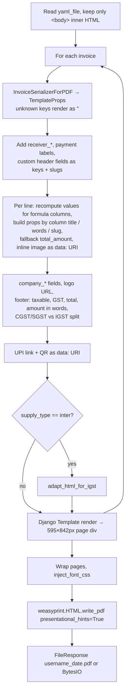

# PDF export flow

How an invoice becomes a PDF, for download, sharing, bulk export and WhatsApp. Creating the invoice itself is in [invoice-generation.md](invoice-generation.md).

## Entry points

| Endpoint | View | Used by | Output |
|---|---|---|---|
| `GET /api/pdf/?id=1,2&template_id=7` | `PdfMaker` (`invoice/api/views.py`) | Web invoice view / new bill / history, template editor test export; mobile "Share PDF" (`downloadPdf` in `MobileApp/services/invoices.ts`) | One PDF, one page per invoice id |
| `POST /api/bulk_export/` `{s, customer[], date_from, date_to, type, invoice_type}` | `BulkExport` | Web `bill_list.jsx`, `SalesRegister.jsx`, `PurchaseRegister.jsx`; mobile reports (`services/reports.ts`) | `type=PDF` → invoice PDFs, `PDF_DATA` → a summary table PDF, anything else → CSV |
| internal `pdf_generator(..., return_bytes=True)` | `bill_share/views.py` | WhatsApp send | `BytesIO` uploaded to Meta |
| `POST /api/weasyprint_preview/` | `yaml_manager/api/views.py` | Web template editor live preview (`WeasyprintPreview.jsx`) | PDF/PNG preview of unsaved HTML |
| `GET /api/yaml/gallery/{id}/preview/` | `GlobalTemplatePreviewView` | Template gallery thumbnails | PNG |

Gates: `PdfMaker` only needs authentication (invoices are filtered by `user_scope_q`). `BulkExport` needs the `bulk_export` plan feature and `invoice.view`.

## Templates

A template is a `yaml_manager.models.Yaml` row, owned by a company:

| Field | Meaning |
|---|---|
| `yaml_file` | The template body: an `.html` file (`is_html=True`) or a coordinate `.yaml` file |
| `pdf_template` | Legacy only: background image for YAML templates (an uploaded PDF is converted to a JPG on save) |
| `elements` | Block-designer JSON the web editor round-trips |
| `is_default` | The company default (one per company, set via `POST yaml/{id}/set-default/`) |
| `is_global`, `is_published`, `global_category` | Product-owner gallery templates; companies clone them (`yaml/gallery/{id}/clone/`, `yaml/onboarding/`) |
| `YamlVersion` | Saved history of the body |

Template CRUD is `yaml/` (GET open to all members; POST/PUT/DELETE need `template_designer` + `template.manage`).

## The two renderers

`invoice/export.py:pdf_generator(qs, request, return_bytes=False, template_id=None)` picks the template with `pick_template(company, template_id)`, then branches on `is_html`:

- `template_id` given → that template, only if it belongs to the company (otherwise 404 "configuration not found");
- no `template_id` → the company default (`is_default=True`), falling back to its oldest template;
- company has no templates → 404.

Callers that omit `template_id` (mobile Share PDF, web `history.jsx`, bulk export, WhatsApp with no WA default template) therefore get the company default.

### HTML templates → WeasyPrint (current path)

Template context available to HTML templates:

- `invoice.*` — serializer fields (including `eway_bill_number`, `eway_bill_date`, `eway_valid_until`, `eway_vehicle_number` and the one-line `eway_bill_line`, blank unless a generated e-way bill is saved), plus `invoice.products[].props.<column>` and `receiver_*`
- `products_data` — list of each line's `props` (flat, easiest for loops)
- `company.*` — name, address, GSTIN, state, email, phone, bank fields, `company_logo`, `upi_id`, `upi_link`, `upi_qr`
- `footer.*` — `total_amount_with_out_gst`, `gst_amount`, `total_amount_with_gst`, `total_amount_in_text`, `cgst`/`sgst`/`igst` (+ `_amount`) from `invoice_api/gst.py:tax_heads`
- top-level custom header keys and `igst`, `igst_amount`

Important details:

- Images must be `data:` URIs. WeasyPrint renders from a string with no base URL, so it would fetch other `` over HTTP back to this server, which breaks behind the tunnel/proxy. Line images (`_product_image_data_uri`) and the UPI QR (`upi_qr.make_qr_data_uri`) are inlined for this reason. The company logo is still an absolute URL.
- Fonts: `pdf_fonts.inject_font_css()` must put `@font-face` rules **in the HTML** for bundled Noto faces (`assets/fonts/`), otherwise Hindi/Devanagari renders blank on hosts without those fonts.
- The UPI QR is only shown if the company has a valid UPI id and the payment block is enabled (`company_upi_link`); `upi_id` follows the same gate.
- A template with bad Django syntax returns 400 with the error instead of a broken PDF.

### YAML templates → ReportLab (legacy path)

For `is_html=False`: `yaml_reader.YamalReader` parses the coordinate layout, `FillValue` fills it with the serialized invoice and company data, and `submit.Submit(...).draw_header_data()` draws text/lines/polygons onto the `pdf_template` background image with ReportLab. Non-Latin text is split into script runs by `pdf_fonts.runs()`; ReportLab does no shaping, so complex scripts may be mis-ordered — use HTML templates for those.

The starter template every new account gets (`invoice_api/static/default_template.yaml`) is a YAML template, so accounts that never pick a gallery template use this path.

### Summary-table PDF and CSV

`pdf_data_generator` renders `html_template_one.html` with `InvoiceSerializerForCSV` rows and totals through WeasyPrint. `csv_generator` dumps the same rows with pandas.

## Client handling

- **Web:** requests with `responseType: 'blob'` and hands the blob to `src/utility/pdf_opener` (opens/downloads, named after the customer).
- **Mobile:** `FileSystem.downloadAsync` to the cache dir with the bearer token, then `Sharing.shareAsync`. It only trusts a 200 with a PDF content type, because the server answers some failures with 200 + a junk `error.pdf`. The first successful share ticks the onboarding checklist (`reportFirstShare`).

## Known gaps

- Render failures return HTTP 200 with a file named `error.pdf` instead of an error status.
- The HTML renderer renders the context per invoice but re-parses the template on every page.
- E-way bill details print only on templates that have one of the `eway_*` fields (HTML) or labels (YAML); no gallery or starter template has them yet.
