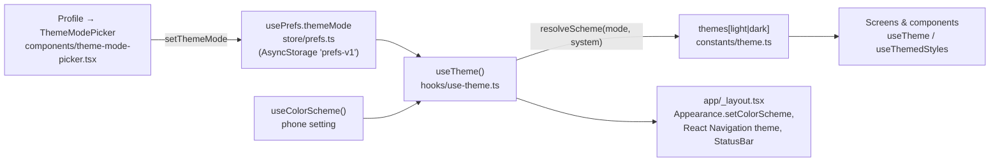

# Theming

The mobile app supports light and dark mode. The web app is light-only with CSS design tokens. Invoice output (previews, PDFs, templates) is always white in both.

Detailed rules live next to the code — read them before UI work:

- Mobile: [`MobileApp/DARK_THEME.md`](../MobileApp/DARK_THEME.md) (token tables, component rules, QA checklist)
- Web: [`bill_makeing_sof/DESIGN_SYSTEM.md`](../bill_makeing_sof/DESIGN_SYSTEM.md)

This page explains how the pieces fit together.

## Mobile app

1. **Choice** — `themeMode` is `system` (default), `light` or `dark`, stored per device in `store/prefs.ts` (Zustand `persist` → AsyncStorage). It is device-local, not synced to the account.
2. **Resolution** — `resolveScheme()` in `constants/theme.ts`: an explicit choice wins, otherwise the phone's scheme, falling back to light.
3. **Tokens** — `ThemeTokens` defines semantic names (`background`, `surface`, `surfaceRaised`, `text`, `textMuted`, `primary`, `success`/`danger`/`warning`/`info` plus `*Soft`, `*Text`, `*Border`, `hero`, `shadowCard`, …). `lightTheme` and `darkTheme` implement them. Dark gets depth from lightness (`background < surface < surfaceRaised`) and has no shadows.
4. **Use in UI** — `const theme = useTheme()` for inline values; `const styles = useThemedStyles(makeStyles)` with a module-level `makeStyles = (t: Theme) => StyleSheet.create(…)`. Never hard-code hex colours (the old `Palette` was removed). `hooks/use-theme-color.ts` and the `Colors` object remain for the Expo template components (`themed-text.tsx`, `themed-view.tsx`).
5. **App shell** — `app/_layout.tsx`:
   - waits for `useThemeReady()` (prefs hydrated) before hiding the splash, so there is no flash of the wrong theme;
   - calls `Appearance.setColorScheme` so native keyboards, alerts and pickers follow the in-app choice;
   - builds a dark React Navigation theme from the tokens (light uses the stock `DefaultTheme`);
   - sets the `StatusBar` style.
6. **Native config** — `app.json` uses `"userInterfaceStyle": "automatic"` with a dark splash background.

Adding a colour: add the token to `ThemeTokens`, give it a value in both `lightTheme` and `darkTheme`, document it in `DARK_THEME.md` section 3.

## Web app

- Tokens are CSS custom properties in `bill_makeing_sof/src/style/tokens.css` (`--brand-indigo`, `--brand-gradient`, `--text*`, `--border*`, `--page-bg`, `--surface`, `--sidebar-*`, …), imported by `src/index.css`. `DESIGN_SYSTEM.md` §12 is their source of truth.
- Tailwind + shadcn/ui (`components.json`, `src/components/ui/`) is used for newer components.
- `src/index.css` declares a Tailwind `dark` variant (`.dark *`), but nothing toggles a `.dark` class, so the web app is effectively light-only. Navigation is a dark indigo sidebar on light content by design.
- Older pages still use per-page CSS in `src/style/` and inline styles; `DESIGN_SYSTEM.md` §11 lists legacy styles to retire.

## Invoice output stays white

PDFs and template previews are rendered by the server (see [pdf-export.md](pdf-export.md)) with a fixed white page (`background: white` in `invoice/export.py`). Neither app's theme reaches them. In the mobile app, any in-app invoice preview must also stay white in dark mode (`DARK_THEME.md` section 6).
