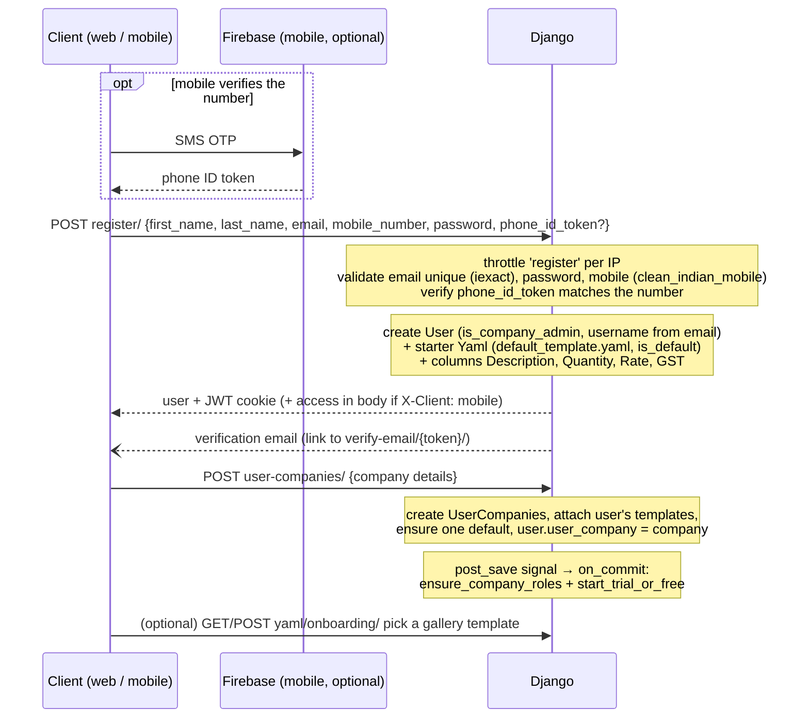

# User signup flow

From "create account" to a usable company with a template, bill columns and a plan.

## Ways in

| Method | Endpoint | View | Clients |
|---|---|---|---|
| Email + password | `POST /api/register/` | `Register_user` + `RegisterSerializer` (`accounts/api/views.py`, `accounts/serializers/serializers.py`) | Web `pages/signup.jsx`, mobile `app/(auth)/signup.tsx` |
| Google | `POST /api/google-login/` `{credential}` | `GoogleLogin` | Web `GoogleLoginButton.jsx`, mobile `components/google-button.tsx` + `lib/google-signin.ts` |
| Phone (SMS OTP) | `POST /api/phone-login/` `{id_token}` | `PhoneLogin` (`accounts/api/views_phone.py`) | Mobile `app/(auth)/phone-login.tsx` + `lib/phone-auth.ts` |
| Invite link | `GET/POST /api/invites/{token}/[accept/]` | `views_invites.py` | Web `InviteAccept.jsx`, mobile `app/invite/[token].tsx` |

Google and phone are sign-in-or-create: an existing account (matched by provider id, then email/number) is signed in; otherwise one is created with `create_user_with_defaults()` and the response carries `created: true`. Invited users join the inviting company instead of creating one.

## Email signup sequence

Steps in detail:

1. **Validate** — email must be unique (case-insensitive; a taken email returns `code: email_exists` so the app can offer "Sign in instead"), Django password validators, Indian mobile normalised. A `phone_id_token` that matches the number makes the account start `mobile_verified` and links the Firebase uid so later SMS login lands in the same account.
2. **Create user and starter data** — the user is the company admin. They get one YAML template marked default and the four default bill columns (see [invoice-generation.md](invoice-generation.md)).
3. **Sign in immediately** — same cookie/body as `Login`, so the client does not make a second request. Audited as `LOGIN` with `method: register`.
4. **Email verification** — `accounts/verification.py` sends a signed link; `GET verify-email/{token}/` sets `email_verified`. `POST resend-verification/` is rate-limited. The mobile `verify-email-banner.tsx` nags until verified.
5. **Company setup** — the client routes to company setup because the user has no verified company:
   - Web: `navigate("/CompanyForm")` after `fetchUser()`. The form checks the GSTIN's check character and fills the state from it; it also holds the GST filing frequency (monthly / quarterly QRMP) and the LUT (number + validity) for exports without IGST. The server repeats the GSTIN and LUT checks (`accounts/serializers/UserCompanies.py`). After setup, the app edits filing frequency and LUT on its GST settings screen (`app/gst-settings.tsx` → `GET/PATCH company/gst-settings/`, `accounts/api/views_gst_settings.py`: members read, admins change).
   - Mobile: `app/_layout.tsx` uses `Stack.Protected` guards. `needsCompany = !user.is_company_varified` shows only `company-setup`; `app/company-setup.tsx` posts `user-companies/`.
6. **Company bootstrap** — `UserCompaniesViewSet.post` creates the company, moves the user's company-less templates into it, guarantees exactly one default template, and marks the company verified. The `post_save` signal in `accounts/signals.py` then (after commit) seeds the company's system roles and calls `companies/trial.py:start_trial_or_free` — a 15-day Pro trial if the company never had one, else the Free plan.
7. **Template pick (optional)** — `yaml/onboarding/` lists the starter plus published gallery templates; choosing one clones it and makes it the default.

## Client session handling

- **Mobile:** `store/session.ts` holds `status` (`loading` / `signedIn` / `signedOut` / `error`), the user and access; the token is stored by `services/token-storage.ts` and added by the axios interceptor in `services/api.ts`. A 401 calls `onUnauthorized` → sign out. On sign-out the React Query cache and its persisted copy are cleared.
- **Web:** cookie-based; Redux `userSlice` / `accessSlice` load `user_info/` and `authz/me/`.

## Login (for reference)

`POST /api/login/` accepts a username or an email. Failure messages are generic, except: a Google-only account is told to use Google, and a deleted account is only revealed to someone who knows the password.

## Known gaps

- Email verification does not block anything; it is advisory.
- The web signup does not do the optional Firebase phone check; only mobile does.
