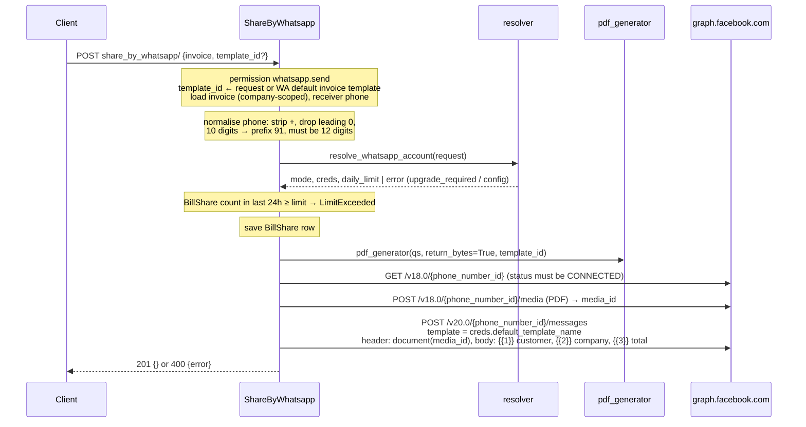

# WhatsApp message flow

Sending an invoice PDF to the customer on WhatsApp through Meta's Cloud API.

## Sending modes

Each company sends either through its **own** WhatsApp Business number or the product's **shared** number. The choice is stored in `CompanyWhatsAppSettings.mode` and resolved by `whatsapp_integration/resolver.py`.

| Mode | Plan feature | Credentials from | Daily limit (`sends_per_day`) fallback |
|---|---|---|---|
| `own` | `whatsapp_integration` | `WhatsAppIntegration` (status `active`) of any company member | 20 |
| `platform` | `whatsapp_shared_number` | `PlatformWhatsAppAccount.get_active()` (managed by the product owner) | `account.default_daily_limit` |

If a company has no settings row yet: `own` when it already has an active integration, otherwise `platform`.

## Models (`whatsapp_integration/models.py`, `bill_share/models.py`)

| Model | Purpose |
|---|---|
| `WhatsAppIntegration` | One per user: WABA id, phone number id, access token, status, `default_template_name` |
| `PlatformWhatsAppAccount` | The shared account; `is_active`, `default_daily_limit` |
| `CompanyWhatsAppSettings` | Company `mode` and `default_invoice_template` (which PDF template to attach) |
| `WhatsAppTemplate` | Message templates synced from / created on Meta |
| `WhatsAppMessage` | Log of test/template messages |
| `BillShare` | One row per invoice share attempt — also the counter for the daily limit |

## Send sequence — `POST /api/share_by_whatsapp/` `{invoice, template_id?}`

`bill_share/views.py:ShareByWhatsapp`. Called by web `comonant/Bill/ExportDropdown.jsx` and mobile `app/invoice/[id].tsx` (`shareOnWhatsapp`).

The message is a Meta **template message** (needed to message a customer outside a 24-hour window). The template must have a document header and three body variables; language is fixed to `en_US`.

## Setting up an own number

Web `pages/WhatsAppConnect.jsx` / `WhatsAppSettings.jsx`, mobile `app/whatsapp.tsx`. All need `whatsapp_integration` + `whatsapp.manage`.

- **Embedded signup** — `POST whatsapp/oauth/ {code, waba_id, phone_number_id}`: exchanges the Meta code for a token (`services.exchange_meta_code_for_token`), validates token/WABA/number, marks the integration `active`.
- **Manual** — `POST whatsapp/config/ {access_token, phone_number_id, business_account_id, pin}`: validates, registers the number with the PIN, creates the `here_is_your_bill_with_time` template on Meta and sets it as `default_template_name`.
- `GET whatsapp/config/` returns status (404 = not configured, which the mobile app treats as normal).
- `whatsapp/template/`, `whatsapp/template/sync/`, `whatsapp/template/{pk}/` manage message templates; `whatsapp/send-test/` sends a test.

## Choosing mode and PDF template

`GET whatsapp/mode/` returns the current mode, the default invoice template and per-mode `available / in_plan / configured / sends_per_day`. `POST whatsapp/mode/ {mode?, default_invoice_template?}` changes either (checks the plan feature for the mode, checks the template belongs to the company) and writes an `AuditLog` row.

## Known gaps

- The `BillShare` row is saved **before** the Meta calls, so failed sends still count toward the daily limit.
- Phone normalisation assumes India (+91) for 10-digit numbers and rejects anything that is not 12 digits.
- Meta Graph API versions are hard-coded (v18.0 for status/media, v20.0 for messages).
- `send_pdf` and `list_of_message_templates` in `bill_share/views.py` use env credentials (`ACCESS_TOKEN`, `PHONE_NUMBER_ID`) and are not used by the send flow.

PDF template used for the attachment: the request's `template_id`, else the WA Settings default invoice template, else the company default template (see [pdf-export.md](pdf-export.md)).
